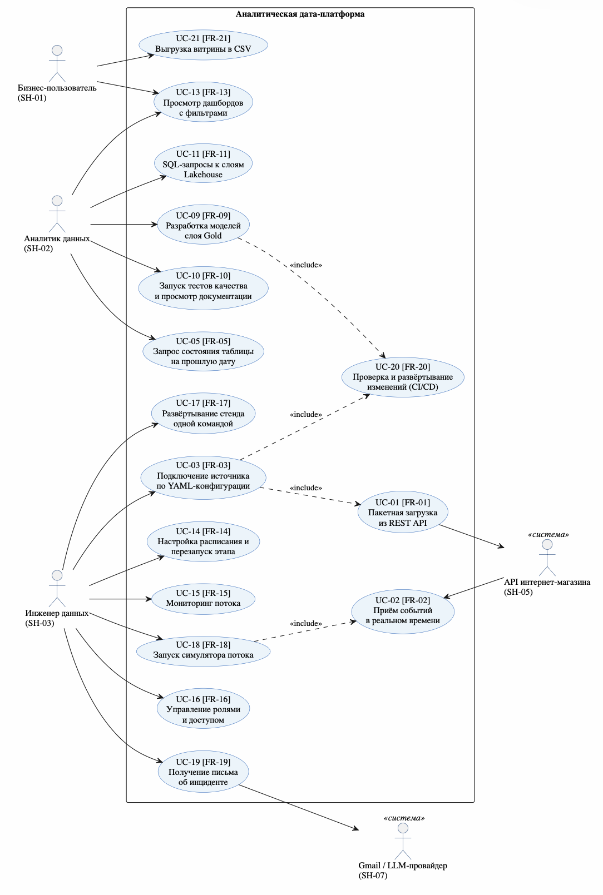

# Лабораторная работа №1. Формулирование требований к программной системе

| Поле | Значение |
|---|---|
| **Студент** | Власова Софья Юрьевна |
| **Группа** | РИС-23-1 |
| **Вариант** | Создание корпоративной дата-платформы для анализа транзакционных данных интернет-магазина (ВКР) |
| **Постановка задачи** | <ссылка на «Возможные варианты.docx»> |
| **Репозиторий** | <ссылка на GitHub/GitFlic> |
| **Дата сдачи** | 21.11.2026 |

**Тема:** Анализ предметной области и формулирование требований к программной системе.

**Цель работы:** Научиться анализировать поставленную задачу, выделять заинтересованных лиц, формулировать функциональные и нефункциональные требования, представлять результаты в виде диаграммы вариантов использования.

---

## Краткое описание системы

Корпоративная аналитическая дата-платформа для интернет-магазина. Это готовый к развёртыванию стенд на архитектуре Data Lakehouse: Kafka, Spark, Apache Iceberg, Trino, dbt, ClickHouse, Superset, Airflow. Предприятие подключает к стенду свой источник данных через REST API или поток событий, описав его в YAML-конфигурации, и получает рассчитанные витрины и BI-дашборды о состоянии бизнеса: продажи, ассортимент, доставка, удержание клиентов. Система рассчитана на небольшие и средние интернет-магазины, которые сейчас готовят отчётность вручную по выгрузкам из рабочей БД и не могут позволить себе собственную платформу данных. Работа стенда демонстрируется на реальном наборе данных Olist (около 100 тыс. заказов), который воспроизводится в виде потока событий с сохранением исходного времени.

---

## Оглавление

1. [Стейкхолдеры](#1-перечень-заинтересованных-лиц-стейкхолдеров)
2. [Функциональные требования](#2-перечень-функциональных-требований)
3. [Диаграмма вариантов использования](#3-диаграмма-вариантов-использования)
4. [Нефункциональные требования](#4-перечень-нефункциональных-требований)
5. [Предположения](#5-перечень-сделанных-предположений-повышенная-сложность)

---

## 1. Перечень заинтересованных лиц (стейкхолдеров)

Выделено 3 стейкхолдера. Все они — прямые пользователи платформы (SH-01 – SH-03), их роли подтверждены опросом 15 сотрудников компании Ecom.tech.

| ID | Стейкхолдер | Роль | Интересы / цели | Влияние |
|----|-------------|------|-----------------|---------|
| SH-01 | Бизнес-пользователь (руководитель, менеджер по продажам, категорийный менеджер) | Потребитель отчётности | Видеть актуальные показатели продаж, ассортимента, доставки и удержания без ожидания отчёта от аналитика; фильтровать по периоду, региону, категории | высокое |
| SH-02 | Аналитик данных / BI-разработчик | Разработчик моделей и витрин | SQL-доступ ко всем слоям, единые правила расчёта метрик, автоматические тесты качества, просмотр данных на прошлую дату для разбора расхождений | высокое |
| SH-03 | Инженер данных / администратор платформы | Эксплуатация стенда | Развёртывание одной командой, подключение источника без программирования, мониторинг потока, быстрая диагностика упавших задач | высокое |

---

## 2. Перечень функциональных требований

Сформулировано 22 требования.Приоритет назначен по методу MoSCoW:
- **Must** — без требования стенд не выполняет свою основную задачу: загрузить данные, построить корректные витрины, показать дашборды;
- **Should** — возможности, которые получили в опросе целевой аудитории среднюю оценку важности от 3,0 до 4,0 или нужны для эксплуатации, но без них стенд остаётся работоспособным;
- **Could** — полезные мелочи;
- **Won't** — сознательно исключено из текущей версии.

| ID | Требование | Стейкхолдер | Приоритет (MoSCoW) | Обоснование |
|----|------------|-------------|---------------------|-------------|
| FR-01 | Система должна выполнять пакетную загрузку данных из файлов (CSV, JSON, Parquet) и из REST API: полную и инкрементальную по полю даты изменения записи | SH-03, SH-05 | Must | Основной способ получения данных; инкрементальная загрузка снижает нагрузку на API источника |
| FR-02 | Система должна принимать события в потоковом режиме через брокер сообщений, сохраняя время события и время поступления | SH-01, SH-03 | Must | 73 % респондентов нужна актуальность данных не хуже 1 часа |
| FR-03 | Инженер может подключить новый источник YAML-конфигурацией без изменения исходного кода | SH-03, SH-04 | Must | Ключевое свойство разрабатываемого стенда; ни один аналог (Databricks, Yandex Cloud, Arenadata) не даёт этого из коробки |
| FR-04 | Система должна приводить данные источника к единому контракту: заказ, позиция, платёж, покупатель, товар, продавец, отзыв | SH-02, SH-05 | Must | Без контракта невозможны предопределённые витрины и дашборды |
| FR-05 | Система должна хранить данные в слоях Bronze, Silver, Gold в открытом табличном формате с транзакциями, эволюцией схемы и снимками | SH-02, SH-04 | Must | Просмотр данных на прошлую дату получил в опросе наивысшую оценку — 4,8 из 5 |
| FR-06 | Система должна проверять схему входящих записей и направлять некорректные записи в карантин (DLQ) без остановки конвейера | SH-02, SH-03 | Must | 87 % респондентов сталкивались с дубликатами и ошибками в данных |
| FR-07 | Система должна выполнять дедупликацию и идемпотентную запись по бизнес-ключу | SH-02 | Must | Брокер гарантирует доставку «как минимум один раз», повторы не должны искажать выручку |
| FR-08 | Система должна агрегировать потоковые данные по времени события с обработкой опоздавших событий | SH-01, SH-02 | Should | Повышает точность оперативных метрик; при свежести «не хуже 1 часа» опоздания частично компенсируются пакетным пересчётом |
| FR-09 | Система должна строить в слое Gold факты и измерения по схеме «звезда» и витрины: продажи, товары, доставка, когорты, метрики потока | SH-01, SH-02 | Must | Набор показателей интернет-магазина типовой и может быть предопределён |
| FR-10 | Система должна запускать тесты качества данных (ключи, допустимые значения, сверка сумм) и генерировать документацию моделей с графом зависимостей | SH-02 | Must | Автоматические проверки качества оценены в 4,4 из 5 (93 % оценок «4–5») |
| FR-11 | Аналитик может выполнять SQL-запросы ко всем слоям через единый SQL-движок | SH-02 | Must | SQL-доступ оценён в 4,6 из 5 |
| FR-12 | Система должна публиковать витрины Gold в колоночную OLAP-СУБД только после успешных тестов качества | SH-01 | Must | Дашборды не должны показывать непроверенные данные; 67 % респондентов жалуются на медленные запросы |
| FR-13 | Пользователь может просматривать готовые дашборды «Продажи», «Ассортимент», «Доставка», «Клиенты», «Мониторинг потока» с фильтрами по периоду, региону и категории | SH-01, SH-02 | Must | Главная ценность для бизнеса; все 100 % респондентов отметили долгое ожидание отчётов |
| FR-14 | Инженер может запускать конвейеры по расписанию и перезапускать отдельный этап без повторного выполнения всего конвейера | SH-03 | Must | Без оркестрации данные не обновляются автоматически |
| FR-15 | Инженер может отслеживать поток: число событий, задержку, отставание чтения, ошибки | SH-03 | Should | Оценка в опросе 3,3; без мониторинга стенд работает, но сбои замечаются позже |
| FR-16 | Система должна разграничивать доступ по ролям: бизнес-пользователь — только чтение витрин, аналитик — чтение всех слоёв и изменение моделей, инженер — администрирование | SH-06 | Should | Оценка в опросе 3,1; обязательно для промышленного использования, но не мешает демонстрации |
| FR-17 | Инженер может развернуть весь стенд одной командой из репозитория с параметрами в файле окружения | SH-03, SH-04 | Must | Большинство респондентов считают допустимым развёртывание не дольше рабочего дня |
| FR-18 | Инженер может воспроизвести исторический набор данных в брокер с сохранением времени события, коэффициентом ускорения и сценариями сбоев (дубли, нарушение порядка, некорректные сообщения) | SH-03 | Must | Без симулятора невозможно проверить потоковый контур и нефункциональные требования на реальных данных |
| FR-19 | При падении задачи оркестратора система должна анализировать лог и код задачи и отправлять инженеру письмо через Gmail с причиной и вариантами решения | SH-03, SH-07 | Should | Сокращает время диагностики; аналог — ИИ-ассистент Databricks; без него сбои разбираются вручную |
| FR-20 | Система должна автоматически проверять изменения в репозитории (линтеры, тесты, сборка образов) и развёртывать стенд после принятия изменений | SH-03, SH-02 | Should | Защищает модели и конфигурации от ошибок; стенд можно обновлять и вручную |
| FR-21 | Бизнес-пользователь может выгрузить данные витрины в CSV | SH-01 | Could | Удобство для дальнейшей работы в Excel; закрывается штатной функцией BI-системы |
| FR-22 | Система обслуживает несколько независимых предприятий в одном развёртывании (мультиарендность) | SH-04 | Won't | Один стенд — одно предприятие; мультиарендность резко усложняет изоляцию данных и доступа |

---

## 3. Диаграмма вариантов использования

Диаграмма построена в PlantUML. Каждый вариант использования помечен ID функционального требования. На диаграмме показаны требования, у которых есть актор-инициатор. Внутренние требования FR-04, FR-06, FR-07, FR-08 и FR-12 выполняются системой автоматически внутри UC-01, UC-02 и UC-09 и отдельными вариантами использования не изображаются. FR-22 имеет приоритет Won't и в диаграмму не входит.

**Связь с требованиями:** ID соответствующего FR указан в названии Use Case (например, `UC-03 [FR-03]`).

### Диаграмма

### Описание ключевого сценария

Ключевым выбран сценарий подключения нового источника: именно он делает стенд универсальным инструментом, а не платформой под один набор данных.

| Поле | Значение |
|---|---|
| **Use Case** | UC-03 [FR-03] Подключение источника по YAML-конфигурации |
| **Актор** | Инженер данных (SH-03); вторичный актор — API интернет-магазина (SH-05) |
| **Предусловие** | Стенд развёрнут (UC-17); у источника есть REST API с пагинацией и полем даты изменения записи; токен доступа к API сохранён в переменной окружения стенда |
| **Основной поток** | 1. Инженер создаёт файл `sources/<имя>.yaml`: адрес API, способ аутентификации, расписание, поле инкрементальной загрузки, пагинация, сопоставление полей с контрактом. → 2. Инженер открывает pull request. → 3. CI проверяет YAML по схеме и выполняет тестовое подключение к API (UC-20). → 4. Инженер сливает изменения в основную ветку. → 5. CD обновляет DAG на стенде. → 6. Оркестратор генерирует DAG загрузки нового источника. → 7. По расписанию сервис коннекторов запрашивает страницы данных из API (UC-01), сопоставляет поля с контрактом и публикует события в Kafka. → 8. Данные проходят слои Bronze → Silver → Gold и появляются на дашбордах. |
| **Постусловие** | Данные нового источника регулярно загружаются и отображаются в витринах; исходный код платформы не изменён, изменения затронули только каталог конфигураций (NFR-14) |
| **Альтернативный поток** | 3а. YAML не прошёл проверку по схеме или API недоступен — CI завершается ошибкой, pull request нельзя слить; инженер исправляет конфигурацию и возвращается к шагу 2. Запись из API не соответствует контракту — она направляется в DLQ (FR-06), остальные записи загружаются; при падении задачи загрузки инженер получает письмо с причиной (UC-19). |

---

## 4. Перечень нефункциональных требований

Выбраны 19 требований, и каждое из них можно проверить на эталонном стенде: один узел, не менее 8 ядер, 24 ГБ ОЗУ, Docker Compose, набор Olist (1 550 922 строки); время измеряется медианой 5 прогонов. Сознательно отброшены:
- доступность «99,9 %» — на одном узле её не подтвердить за время работы;
- горизонтальное масштабирование на кластер — не нужно для объёма данных магазина малого и среднего бизнеса;
- требования к мобильному интерфейсу — его нет;
- секундная задержка потока — опрос показал, что большинству достаточно свежести не хуже 1 часа.

| ID | Категория | Требование | Метрика / критерий приёмки | Почему выбрано |
|----|-----------|------------|----------------------------|----------------|
| NFR-01 | Resource efficiency | Стенд работает на одной машине без нехватки памяти | Суммарный лимит памяти контейнеров ≤ 20 ГБ; 0 ошибок OOM под нагрузкой NFR-04 | Целевая аудитория — малый и средний бизнес, один сервер |
| NFR-02 | Performance | Полная пакетная загрузка набора Olist до опубликованных витрин | ≤ 15 мин (медиана 5 прогонов по журналу оркестратора) | Первичная загрузка и пересчёт должны укладываться в рабочий цикл |
| NFR-03 | Scalability | Рост объёма данных не ломает пакетный контур | При ×10 объёма фактов время растёт ≤ 10× | Магазин растёт; проверяем, что масштабирование хотя бы линейное |
| NFR-04 | Performance (throughput) | Потоковый контур выдерживает нагрузку | ≥ 1000 событий/с в течение 10 мин; отставание потребителя ≤ 30 000 сообщений и не растёт монотонно | С запасом перекрывает поток заказов магазина малого и среднего бизнеса |
| NFR-05 | Performance (freshness) | Витрины Gold актуальны | Свежесть ≤ 1 ч (замер каждые 5 мин в течение 1 ч) | 73 % респондентов нужна актуальность не хуже 1 часа |
| NFR-06 | Performance (latency) | Запросы дашбордов быстрые | Serving-слой: медиана ≤ 1 с, максимум ≤ 3 с; через SQL-движок к Gold: медиана ≤ 10 с (10 эталонных запросов × 10 повторов) | 67 % респондентов жалуются на медленные запросы |
| NFR-07 | Usability | Дашборд загружается за приемлемое время | Любой из 5 дашбордов с фильтром «весь период» ≤ 20 с | Бизнес-пользователь не должен ждать отчёт |
| NFR-08 | Correctness | Витрины совпадают с источником | Расхождение по числу заказов и позиций = 0 | Рассогласование метрик — одна из главных проблем ручной отчётности |
| NFR-09 | Reliability (idempotency) | Повторная доставка не искажает данные | При повторе 10 % событий число записей и суммы в Silver/Gold не меняются; 0 дубликатов по ключу | Kafka гарантирует доставку «как минимум один раз» |
| NFR-10 | Reliability (late data) | Опоздавшие события не теряются | Задержка ≤ 10 мин | Порядок событий в сети не гарантирован |
| NFR-11 | Fault tolerance | Некорректные сообщения не останавливают конвейер | При 1 % некорректных сообщений 100 % из них в DLQ, 0 остановок конвейера | Источники присылают «грязные» данные (87 % респондентов) |
| NFR-12 | Recoverability | Стенд восстанавливается после сбоя потребителя | После остановки на 5 мин: 0 потерь и 0 дублей, отставание ликвидировано ≤ 5 мин при 1000 событий/с; хранение сообщений в брокере ≥ 3 суток | Перезапуски контейнеров неизбежны при эксплуатации |
| NFR-13 | Maintainability | Модели покрыты тестами и описаны | 100 % моделей Gold с тестами unique/not_null на ключ и relationships на внешние ключи; 100 % тестов проходят; 100 % моделей и столбцов с описанием | Единые проверенные правила расчёта метрик |
| NFR-14 | Extensibility | Новый источник подключается без изменения кода | Изменения только в каталоге конфигураций (по git diff); объём конфигурации ≤ 300 строк | Суть «универсального стенда» (FR-03) |
| NFR-15 | Reliability (history) | Доступны прошлые состояния данных | Запрос к любому снимку Silver/Gold за последние 7 суток | Самая высокая оценка в опросе — 4,8 из 5 |
| NFR-16 | Security | Права разграничены, секреты не утекают | Бизнес-пользователь не имеет доступа на запись и к Bronze/Silver (негативные тесты → ошибка доступа); 0 находок сканера секретов в репозитории | Требование службы ИБ |
| NFR-17 | Portability (installability) | Стенд быстро разворачивается | Одна команда из чистой копии репозитория; все сервисы прошли проверку работоспособности ≤ 10 мин (без загрузки образов) | Большинство считает допустимым срок развёртывания не дольше 1 рабочего дня |
| NFR-18 | Correctness (AI agent) | ИИ-агент верно определяет причину сбоя и быстро сообщает о ней | На 20 смоделированных сбоях верная причина ≥ 80 %; письмо приходит ≤ 60 с после падения задачи | Подтверждает практическую пользу агента, а не только его наличие |
| NFR-19 | Maintainability (CI/CD) | Проверки изменений автоматические и быстрые | 100 % pull request проходят CI; полный прогон CI ≤ 15 мин | Быстрая обратная связь разработчику |

---

## 5. Перечень сделанных предположений (повышенная сложность)

Постановка задачи не описывает конкретное предприятие и его источник данных. Поэтому параметры источника, нагрузки, окружения и внешних сервисов додуманы. Предположения, которые касаются пользователей, по возможности опираются на результаты опроса.

| ID | Предположение | Влияние на требования |
|----|---------------|-----------------------|
| A-01 | Источник предоставляет REST API с пагинацией и полем даты последнего изменения записи и (или) может отправлять webhooks | Определяет FR-01 и FR-03: возможна инкрементальная загрузка по полю `updated_at`; при отсутствии такого поля пришлось бы делать полные выгрузки |
| A-02 | Данные любого интернет-магазина можно сопоставить с 7 сущностями контракта (заказ, позиция, платёж, покупатель, товар, продавец, отзыв) | Делает возможными FR-04 и предопределённые витрины FR-09, FR-13 |
| A-03 | Набор Olist достаточно репрезентативен для проверки платформы, а его воспроизведение с сохранением времени события адекватно моделирует реальный поток | Обосновывает FR-18 и проверку NFR-02 – NFR-12 на этих данных; события без собственной метки времени помечаются как синтетические |
| A-04 | Один стенд обслуживает одно предприятие | Мультиарендность вынесена в Won't (FR-22); упрощает FR-16 и NFR-16 |
| A-05 | Объём данных клиента сопоставим с Olist (до ~10× больше) и умещается на одном сервере | Позволяет развёртывание в Docker Compose (FR-17, NFR-17) и бюджет памяти NFR-01; задаёт границу масштабирования NFR-03 |
| A-06 | Пиковый поток событий магазина — не более нескольких сотен в секунду | Порог NFR-04 (1000 событий/с) взят с запасом |
| A-07 | Для оперативного мониторинга достаточно свежести витрин не хуже 1 часа | Задаёт NFR-05  |
| A-08 | Часы источника синхронизированы, а основная масса событий опаздывает не более чем на 10 минут | Задаёт порог опоздания в FR-08 и NFR-10 |
| A-09 | Допускается отправка логов задач во внешнюю LLM после маскирования секретов и персональных данных; если политика компании это запрещает, используется локальная модель | Определяет реализацию FR-19 и меры NFR-16 |
| A-10 | У компании есть аккаунт Gmail с двухэтапной аутентификацией и паролем приложения для отправки писем по SMTP | Необходимо для FR-19 и проверки времени доставки в NFR-18 |
| A-11 | Пользователи работают с дашбордами из настольного браузера | Мобильный интерфейс не требуется; NFR-07 измеряется в настольном браузере |
