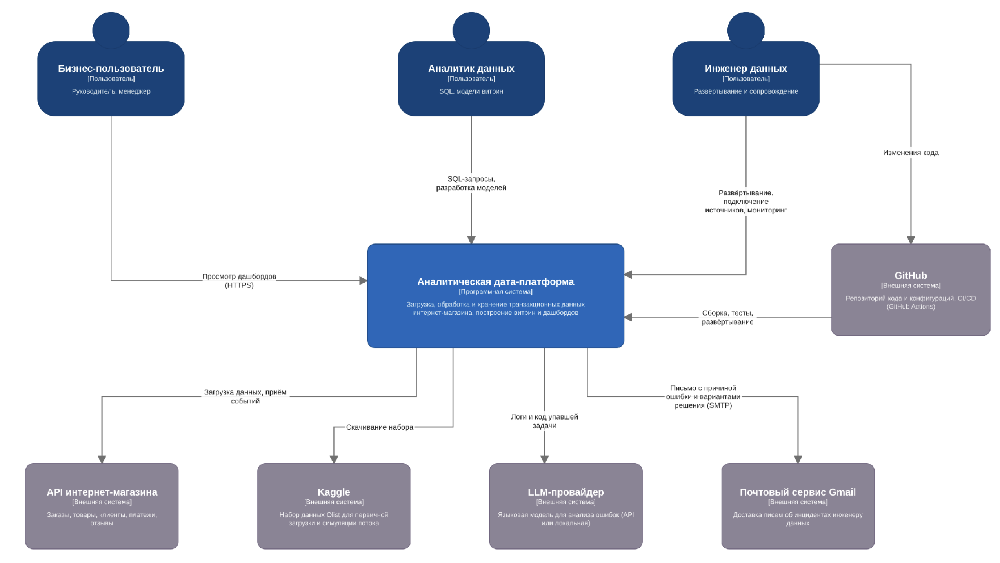
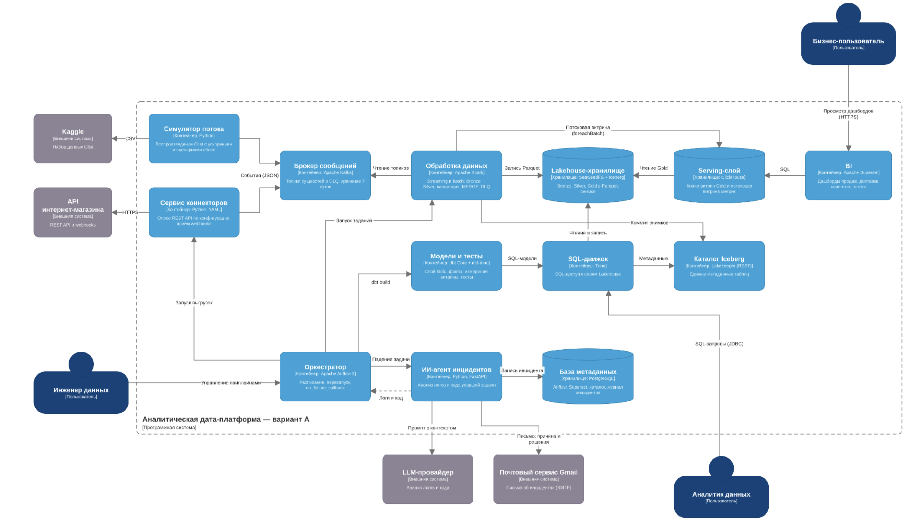
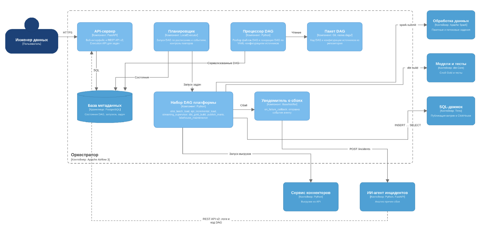
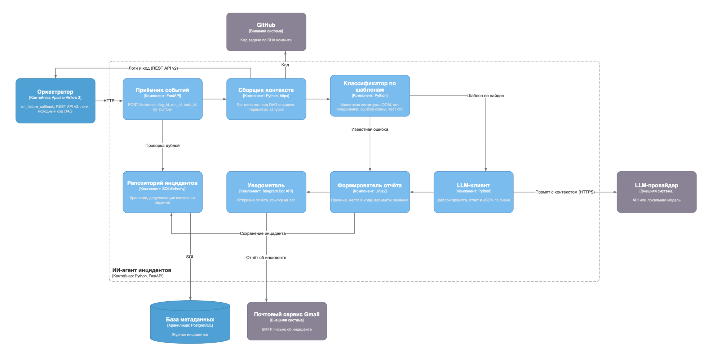

# Лабораторная работа №2. C4 model для проектирования архитектуры программной системы

## Титульный блок

| Поле | Значение |
|---|---|
| **Студент** | Власова Софья Юрьевна |
| **Группа** | РИС-23-1 |
| **Вариант** | Разработка корпоративной дата-платформы для обработки и анализа транзакционных данных интернет-магазина |
| **Ссылка на ЛР №1** | https://github.com/Vlasovasona/ecommerce-data-platform/blob/main/LAB_1.md |
| **Репозиторий** | https://github.com/Vlasovasona/ecommerce-data-platform |
| **Инструмент диаграмм** | Draw.io |

**Тема:** Использование нотации C4 model для проектирования архитектуры программной системы.

**Цель:** Получить опыт использования графической нотации для фиксации архитектурных решений.

---

## Краткое описание системы

Разрабатываемая система - готовая к развёртыванию аналитическая дата-платформа для интернет-магазина, принимающая транзакционные данные через REST API и в форме событий. Она объединяет пакетную и потоковую обработку, хранение данных в архитектуре Data Lakehouse, построение аналитических витрин и BI-дашбордов. Основные пользователи - бизнес-пользователь, аналитик данных и инженер данных; для демонстрации используется набор Olist.

**Ключевые NFR из главы 1 ВКР, влияющие на архитектуру:** НFT-1 (лимит памяти 24 ГБ), НFT-5 (свежесть витрин до 1 часа), НFT-6 (скорость аналитических запросов), НFT-9 (идемпотентность), НFT-12 (восстановление потоковой обработки), НFT-14 (подключение источников конфигурацией), НFT-16 (разграничение доступа).

---

## Оглавление

1. [Диаграмма системного контекста](#1-диаграмма-системного-контекста)
2. [Диаграмма контейнеров](#2-диаграмма-контейнеров)
3. [Диаграмма компонентов](#3-диаграмма-компонентов-контейнер-оркестратор-apache-airflow-3)
4. [Компоненты второго контейнера](#4-компоненты-второго-контейнера-контейнер-ии-агент-инцидентов)

---

## 1. Диаграмма системного контекста

Диаграмма показывает аналитическую дата-платформу как единую проектируемую систему, её три пользовательские роли и внешние системы: API интернет-магазина, Kaggle, GitHub, LLM-провайдера и почтовый сервис Gmail.

### Диаграмма

### Описание элементов

| Элемент | Тип | Назначение |
|---|---|---|
| Аналитическая дата-платформа | System (проектируемая) | Загрузка, обработка, хранение и анализ транзакционных данных; витрины и дашборды |
| Бизнес-пользователь | Person | Просмотр дашбордов и показателей интернет-магазина |
| Аналитик данных | Person | SQL-запросы, разработка моделей аналитических витрин |
| Инженер данных | Person | Развёртывание платформы, подключение источников, мониторинг конвейеров |
| API интернет-магазина | External System | Источник заказов, товаров, покупателей, платежей и отзывов |
| Kaggle | External System | Предоставление набора данных Olist для загрузки и воспроизведения событий |
| GitHub | External System | Репозиторий кода и конфигураций, CI/CD через GitHub Actions |
| LLM-провайдер | External System | Анализ неизвестных ошибок конвейеров по логам и коду |
| Почтовый сервис Gmail | External System | Доставка писем об инцидентах инженеру данных |

### Внешние интеграции

| Внешняя система | Протокол | Назначение |
|---|---|---|
| API интернет-магазина | HTTPS/REST, webhooks | Пакетное чтение данных и получение событий; направление обмена двустороннее в зависимости от сценария |
| Kaggle | HTTPS (загрузка файлов CSV) | Получение исторического набора Olist |
| GitHub | Git/HTTPS, GitHub Actions | Получение кода и конфигураций, CI/CD |
| LLM-провайдер | HTTPS/API | Передача контекста инцидента, получение структурированного анализа |
| Gmail | SMTP | Отправка уведомлений о сбоях |

---

## 2. Диаграмма контейнеров

Диаграмма раскрывает архитектуру варианта A: отдельные сервисы коннекторов, оркестрации, обработки, SQL-запросов, публикации и визуализации используют брокер событий и единое Lakehouse-хранилище. Сервисы взаимодействуют по сетевым интерфейсам; данные Bronze, Silver и Gold хранятся в таблицах Apache Iceberg.

### Диаграмма

### Описание контейнеров

| Контейнер | Тип | Технология | Назначение | Какие FR покрывает |
|---|---|---|---|---|
| Симулятор потока | Container: Worker | Python | Воспроизведение событий Olist и сценариев сбоев | FT-19 |
| Сервис коннекторов | Container: Service/API | Python, YAML | Получение данных из REST API и webhooks, проверка контракта | FT-1–FT-4 |
| Брокер сообщений | Container: Message Broker | Apache Kafka (KRaft) | Очереди событий, хранение топиков и DLQ | FT-2, FT-6 |
| Обработка данных | Container: Processing Service | Apache Spark | Пакетные и потоковые задания; Bronze, Silver; потоковые метрики | FT-5–FT-8 |
| Lakehouse-хранилище | Container: Data Store | SeaweedFS, Apache Iceberg | Объектное хранение таблиц Bronze, Silver, Gold | FT-5 |
| Каталог Iceberg | Container: Metadata Service | Lakekeeper (REST) | Общий каталог таблиц Iceberg | FT-5, FT-11 |
| SQL-движок | Container: Query Service | Trino | SQL-доступ к данным Lakehouse | FT-11 |
| Модели и тесты | Container: Data Transformation | dbt Core, dbt-trino | Gold-витрины, тесты качества, документация | FT-9, FT-10 |
| Serving-слой | Container: Database | ClickHouse | Копии витрин и оперативные метрики для BI | FT-12 |
| BI | Container: Web Application | Apache Superset | Дашборды и разграничение прав | FT-13, FT-16 |
| Оркестратор | Container: Scheduler | Apache Airflow 3 | Управление DAG, расписанием и перезапусками | FT-14 |
| ИИ-агент инцидентов | Container: API Service | Python, FastAPI | Анализ ошибок и уведомления инженера | FT-19 |
| База метаданных | Container: Database | PostgreSQL | Метаданные Airflow, Superset, каталога и журнал инцидентов | - |

### Выбор архитектурного стиля - сравнение

Выбрана модульная сервисная архитектура Data Lakehouse с событийным обменом через Apache Kafka и разделением пакетных и потоковых задач обработки в Apache Spark. В отличие от варианта B, она не требует дублирования расчёта метрик в Spark и ClickHouse, что упрощает контроль согласованности и идемпотентности (НFT-9). Вариант C с построением Gold в Greenplum отклонён, поскольку выводит основной аналитический слой из Lakehouse и увеличивает зависимость от отдельного MPP-хранилища. Выбранное решение обеспечивает требуемую свежесть витрин до 1 часа (НFT-5), поддерживает расширяемость источников через конфигурации (НFT-14) и выделяет ClickHouse для быстрых BI-запросов (НFT-6). Совместное использование Iceberg и Kafka поддерживает воспроизводимость данных и восстановление обработки после сбоев (НFT-12).

---

## 3. Диаграмма компонентов (контейнер «Оркестратор Apache Airflow»)

Для детализации выбран оркестратор, поскольку он координирует загрузку, преобразование, тестирование и публикацию данных. На диаграмме показаны внутренние компоненты Apache Airflow 3 и их взаимодействие с другими контейнерами.

### Диаграмма

### Описание компонентов

| Компонент | Роль | Технология | Покрываемые FR |
|---|---|---|---|
| API-сервер | API Layer / Controller | Airflow 3, FastAPI | FT-14 |
| Планировщик | Application Service | Airflow Scheduler / LocalExecutor | FT-14 |
| Процессор DAG | Application Service | Airflow DAG Processor, Python | FT-3, FT-14 |
| Пакет DAG | Конфигурация/описания заданий | Git, Python | FT-1, FT-9, FT-14 |
| Набор DAG платформы | Application Services / Use Cases | Python, Apache Airflow DAG | FT-1, FT-9, FT-10, FT-12, FT-14 |
| Уведомитель о сбоях | Event Publisher / Integration | Python, Airflow, HTTP | FT-19 |

*Хранилище PostgreSQL и сервисы Spark, dbt, Trino, коннекторов и ИИ-агента находятся за границей контейнера и не считаются его внутренними компонентами. Привязка FT к компонентам дополнена в таблице отчёта, но на самом рисунке не указана.*

---

## 4. Компоненты второго контейнера (контейнер «ИИ-агент инцидентов»)

ИИ-агент выбран как дополнительный контейнер, поскольку реализует другой тип обработки: реагирует на событие отказа Airflow, собирает сведения о сбое, определяет причину по известному шаблону или с помощью LLM и направляет уведомление инженеру.

### Диаграмма

### Описание компонентов

| Компонент | Роль | Технология | Покрываемые FR |
|---|---|---|---|
| Приёмник событий | Controller / API Layer | FastAPI | FT-19 |
| Сборщик контекста | Application Service / Integration | Python, HTTPX | FT-19 |
| Классификатор по шаблонам | Domain Service | Python | FT-19 |
| LLM-клиент | Integration | Python, HTTPS/API | FT-19* |
| Формирователь отчёта | Application Service | Python, Jinja2 | FT-19 |
| Уведомитель | Integration / Notification Publisher |  Gmail SMTP | FT-19 |
| Репозиторий инцидентов | Repository | SQLAlchemy, PostgreSQL | FT-19 |

---
